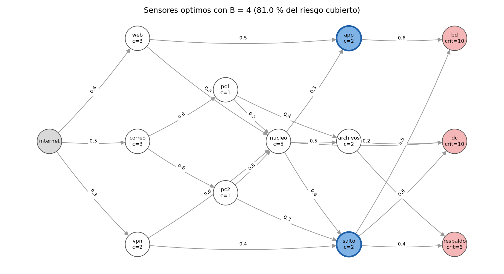

# SentinelPlace

**Optimal placement of intrusion detection sensors in a network using integer linear programming and the simplex method.**

An organization rarely has the budget to monitor every machine in its network. SentinelPlace models the network as a graph, finds the attack paths an intruder is most likely to follow toward critical assets, and selects the set of sensor locations that intercepts the most risk without exceeding a given budget.

With 4 budget units on the study network, the model covers **81% of the attack risk**. The intuitive strategy of monitoring the most connected node covers only 56% with the same budget.

> Course project for *Optimization Methods* (Yachay Tech University). The network is a synthetic scenario designed for the study; it does not describe any real infrastructure.

---

## How it works

The solution is a three-stage pipeline:

1. **Network as a graph.** Nodes are machines (web server, VPN, workstations, application server, domain controller, database…). Each directed edge carries the probability that an attacker on one machine manages to move to the next one (lateral movement).
2. **Attack path generation.** The probability of a path is the product of its edge probabilities. Since `log(a·b) = log a + log b`, maximizing that product is equivalent to minimizing the sum of `−log p`, so Yen's algorithm (`networkx.shortest_simple_paths`) returns the *k* most probable paths to each critical asset. Each path is weighted by *criticality of the target × path probability*.
3. **Optimization model.** A budgeted maximum coverage problem, formulated as a binary integer linear program and solved with HiGHS through PuLP.

## Mathematical model

**Sets and parameters:** candidate nodes $J$, attack paths $P$, nodes $J_p \subseteq J$ on path $p$, sensor cost $c_j$, path weight $w_p$, budget $B$.

**Decision variables:** $x_j = 1$ if a sensor is installed at node $j$; $y_p = 1$ if path $p$ is covered.

$$
\begin{aligned}
\max \quad & Z = \sum_{p \in P} w_p \, y_p \\
\text{s.t.} \quad & y_p \le \sum_{j \in J_p} x_j && \forall p \in P \quad \text{(coverage)} \\
& \sum_{j \in J} c_j \, x_j \le B && \text{(budget)} \\
& x_j, \, y_p \in \{0, 1\}
\end{aligned}
$$

A path can only count as covered if at least one of its nodes has a sensor. Critical assets themselves are not candidates: detecting the attacker once it has reached the asset is too late. When the budget allows several optimal solutions, a second (lexicographic) phase minimizes cost among them, so no useless sensors are installed.

## Results

### Study network (13 nodes, 23 edges, 15 attack paths)



| Budget | Risk covered | Sensors |
|---|---|---|
| 1 | 17.8% | pc1 |
| 2 | 42.5% | app |
| 3 | 56.3% | pc1, salto |
| **4** | **81.0%** | **app, salto** |
| 5 | 93.1% | pc1, app, salto |
| 6 or more | 100% | app, archivos, salto |

Findings:

- **Coverage shows diminishing returns:** each additional budget unit buys less risk from B = 3 onward.
- **Optimal solutions are not cumulative:** with B = 3 the optimum includes `pc1`, but with B = 4 it drops it for `app`. A strategy that adds sensors one by one cannot make that change.
- **The most central node is never chosen:** the core switch has the highest betweenness centrality, but the riskiest paths bypass it.
- **The model beats intuition:** a greedy heuristic based on centrality falls up to 53 percentage points behind the optimum.
- **The recommendation is robust:** across 300 scenarios with ±20% error in every probability, the base solution remains optimal in 75.7% of them, with an average loss of 1.6% when it is not.
- **It scales:** a 400-node network is solved in about a tenth of a second.

### Small verification instance

A 5-node, 5-path instance with budget 4 small enough to solve by hand. Its optimum (sensors at W and T, Z = 12 out of 15) was obtained through five independent methods that all agree:

| Method | Type |
|---|---|
| Enumeration of the 10 feasible sensor sets | Manual |
| Simplex tableau, root node, iterations 1–3 (Excel) | Manual, verified cell by cell |
| Exhaustive search (`instancia_pequena.py`) | Code |
| Branch and bound with a simplex tableau written from scratch (`simplex_tablas.py`) | Code, exact fractions |
| HiGHS through PuLP | Solver |

The linear relaxation gives Z = 12.5 with *half* a sensor at the VPN, which shows why integer variables are required. Branch and bound needs only three nodes to prove optimality, and the final simplex tableau exposes the budget shadow price (5/2).

## Repository structure

```text
sentinelplace/
├── red.py               Study network: nodes, roles, costs, criticality, edge probabilities
├── rutas.py             Attack path generation (−log p transformation + Yen's algorithm)
├── modelo.py            Generic ILP with lexicographic tie-breaking and LP relaxation
└── visualizar.py        Network and budget-curve figures
instancia_pequena.py     Small instance: ILP, LP relaxation and brute force
ejecutar_red.py          Study network, budget sensitivity and figures
analisis.py              Heuristics, shadow price, cost and probability sensitivity, scalability
simplex_tablas.py        Simplex tableau from scratch; compares against HiGHS and manual work
manual/                  Manual simplex iterations in Excel
resultados/              Generated figures, CSV files and simplex tableaux
tests/                   21 automated tests
```

## Getting started

Requires **Python 3.12 or later** (needed by PuLP 4).

```bash
git clone https://github.com/FauGut06/Sentinelplace.git
cd Sentinelplace
python -m venv .venv
.venv\Scripts\activate          # Windows
# source .venv/bin/activate     # macOS / Linux
pip install -r requirements.txt
```

Run the experiments:

```bash
python instancia_pequena.py     # small instance, relaxation and brute force
python ejecutar_red.py          # study network, budget sensitivity and figures
python analisis.py              # heuristics, shadow price, sensitivity and scalability
python simplex_tablas.py        # simplex tableaux for the three branch-and-bound nodes
python -m pytest -q tests       # automated validation (21 tests)
```

All random scenarios use fixed seeds, so every run reproduces the same numbers. Outputs are written to `resultados/`.

To check a manual simplex resolution against the code (it reports the first wrong cell without revealing the correct value):

```bash
python simplex_tablas.py --comparar-tablas manual/tablas_nodo0.xlsx
```

## Validation

- The optimum matches exhaustive search for every budget from 0 to 12 (2⁹ = 512 sensor combinations).
- The from-scratch simplex matches HiGHS in all three branch-and-bound nodes (25/2, 12 and 35/3).
- The LP relaxation is always an upper bound of the integer optimum.

## Limitations

- **Synthetic data:** probabilities, costs and criticalities are illustrative. In practice they would come from vulnerability scans (CVSS or EPSS), firewall rules and a business impact analysis.
- **Independence:** path probability assumes each step is independent of the previous ones.
- **Truncated paths:** only the *k* most probable paths per entry–target pair are modeled, so "100% coverage" refers to those paths, not to every possible one.
- **Perfect detection and a static attacker:** a sensor is assumed to always detect an attack crossing its node, and the attacker does not adapt to the sensors.

## Tech stack

Python · PuLP · HiGHS · NetworkX · Matplotlib · openpyxl · pytest
